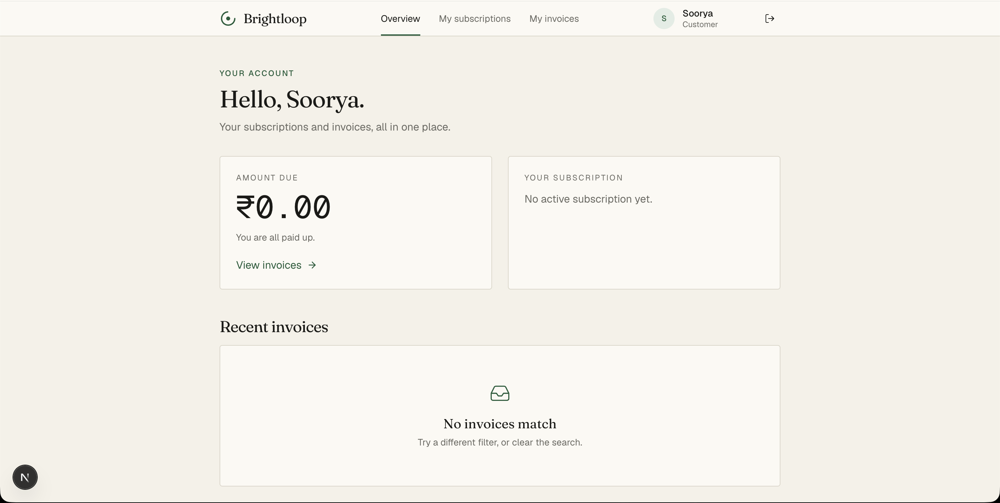
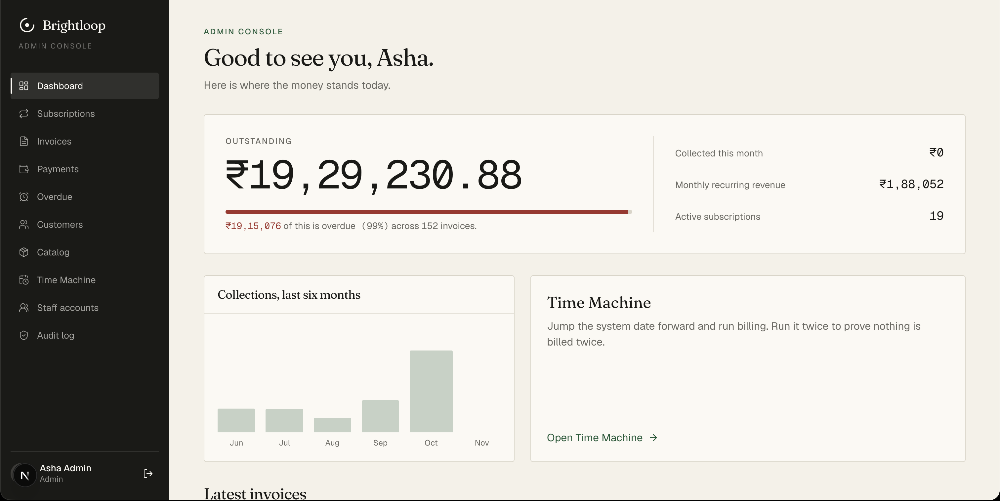
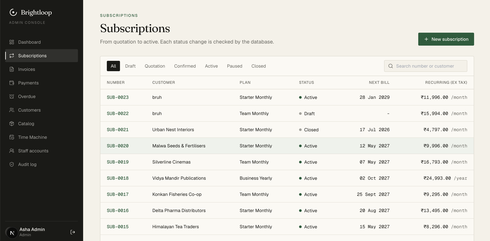
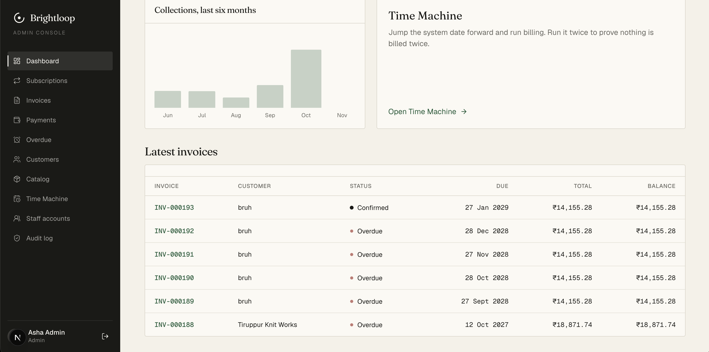
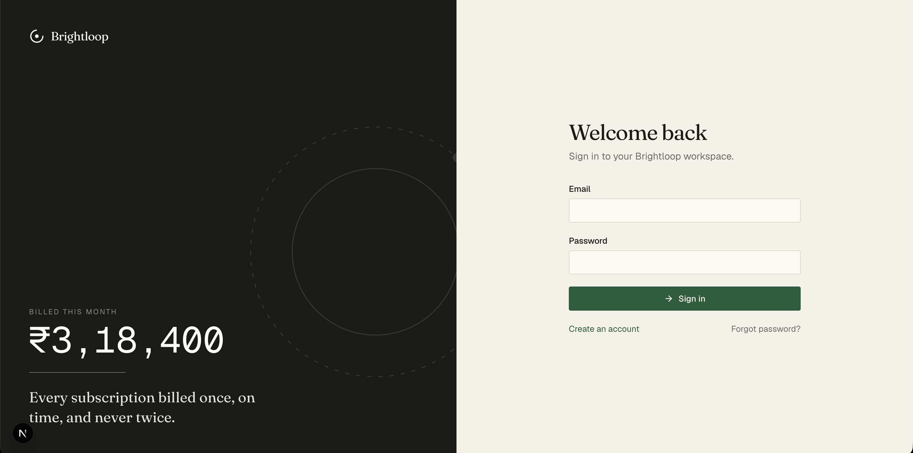

# Brightloop

Brightloop Software sells its products on subscription, and until now it has run the whole thing out of spreadsheets: who signed up for what, when the next invoice is due, who has paid, who hasn't. This project replaces those spreadsheets with one system that follows a single pipeline from start to finish:

**Product → Plan → Subscription → Invoice → Payment → Report**

We built it for a five-hour hackathon, and the database got the most attention. Most of the rules (valid status changes, invoice math, "you can't pay more than you owe") live in PostgreSQL itself rather than in application code, so the app can't get into a bad state even when the code around it is wrong.

---

## The short version

| If you are... | You can... |
|---|---|
| **Admin** | Set up taxes, products and plans, add staff, read the audit log, and move the system clock with the Time Machine |
| **Staff** | Manage customers, build subscriptions, run billing, confirm and send invoices, record payments, chase overdue ones |
| **Customer** | Sign up, then see your own subscriptions and invoices (and print them). Nothing else |

The part we're proudest of is the **Time Machine**. The system keeps its own idea of "today" in a one-row table. The admin can jump that date forward, click *Run billing*, and watch invoices appear. Click it a second time and nothing happens. That second click is the whole point: the same period can never be billed twice, and the database enforces that, not just our code.

---

## Contents

- [Running it](#running-it)
- [Demo logins](#demo-logins)
- [Features in detail](#features-in-detail)
  - [Time Machine](#time-machine)
  - [Billing engine](#billing-engine)
  - [Catalog: taxes, products, plans](#catalog-taxes-products-plans)
  - [Customers](#customers)
  - [Subscriptions and their lifecycle](#subscriptions-and-their-lifecycle)
  - [Discounts](#discounts)
  - [Invoices](#invoices)
  - [Payments](#payments)
  - [Overdue tracking](#overdue-tracking)
  - [Dashboard and reports](#dashboard-and-reports)
  - [Customer portal](#customer-portal)
  - [Accounts, login and roles](#accounts-login-and-roles)
  - [Audit log](#audit-log)
  - [Live updates](#live-updates)
- [The database](#the-database)
- [How the code is laid out](#how-the-code-is-laid-out)
- [The interface](#the-interface)
- [API](#api)
- [Tests](#tests)
- [Performance](#performance)
- [What isn't finished](#what-isnt-finished)

---

## Running it

You need Python 3.11+, Node 20+, and a PostgreSQL database. Docker is optional; it's only there to give you a local Postgres and a mail catcher.

```bash
cp .env.example .env            # then edit it, see below
cd backend
python3 -m venv .venv && source .venv/bin/activate
pip install -r requirements.txt
uvicorn app.main:app --reload --port 8000
```

In a second terminal:

```bash
cd frontend
npm install
npm run dev
```

Open http://localhost:3000. The API's interactive docs are at http://localhost:8000/docs.

If you'd rather use the Makefile, `make db-up`, `make migrate`, `make seed`, `make api`, `make web` and `make test` do the obvious things.

**Which database?** There are two ways to set `DATABASE_URL` in `.env`:

- *Shared Supabase database* (what the team used). Use the **Session pooler** connection string on port 5432. Not the transaction pooler on 6543: it breaks `LISTEN/NOTIFY`, which we use. The schema and demo data are already loaded, so don't run migrations or the seed again.
- *Local Postgres* via `make db-up`. You start empty, so run `make migrate` and then the seed (below).

**Seeding a fresh database**

```bash
make migrate                                  # applies database/migrations/*.sql in order
backend/.venv/bin/python database/seed/seed.py            # logins, catalog, ~20 customers, ACTIVE subscriptions
# then log in as admin, open Time Machine, set a date ~6 months back, and run billing to catch up
backend/.venv/bin/python database/seed/seed_payments.py   # payments on ~75% of the invoices
```

The seed script deliberately does not insert invoices itself. Invoices come from the real billing engine, so the numbers on screen are the numbers the engine actually produces.

**Email.** Password-reset emails go through SMTP. Locally, run [Mailpit](https://github.com/axllent/mailpit) (`make db-up` starts one) and read mail at http://localhost:8025. If no mail server is running, the reset link is printed in the API's terminal instead, so nothing is blocked.

**Windows.** `make` isn't installed by default. Use the commands above directly (`py -m venv .venv`, `.venv\Scripts\Activate.ps1`).

**How the browser reaches the API.** Next.js proxies everything under `/api/*` to FastAPI on port 8000, so the browser only ever talks to one origin. That's why there's no CORS setup and why the login cookie just works.

---

## Demo logins

All three share one password: `Brightloop@123`

| Role | Email |
|---|---|
| Admin | `admin@brightloop.example.com` |
| Staff | `staff@brightloop.example.com` |
| Customer | `customer@kaveri.example.com` |

The customer account belongs to Kaveri Textiles, so it sees only Kaveri's subscriptions and invoices.


A fresh install has no admin at all. If you start from an empty database, set `ADMIN_BOOTSTRAP_TOKEN` in `.env` and call `POST /auth/bootstrap-admin` once. It refuses to run again after an admin exists.

---

## Features in detail

### Time Machine

Everything in the app that depends on "today" (overdue status, the dashboard numbers, which subscriptions are due for billing) reads one value: `app_clock.today`. Nothing in the business logic calls `date.today()` or `CURRENT_DATE`.

Because of that, moving the clock moves the whole system consistently. The admin page offers:

- **Set** the date to an exact day.
- **Advance** by a number of days and/or months. Month arithmetic is done by Postgres, so 31 January plus one month is 28 February, not a crash.
- A **Run billing** button right next to it, which reports what happened: how many invoices were created, how many were skipped, how many subscriptions auto-closed, and how many were already up to date.

Only admins can touch the clock. Staff can run billing but can't change the date.

### Billing engine

`run_billing` turns every due, active subscription into invoices. It takes no date argument; it reads the clock.

How it works, in order:

1. **Auto-close.** Subscriptions past their expiry whose plan says `auto_close` are closed first.
2. **Find what's due.** Active subscriptions with `next_billing_date <= today` are selected and row-locked (`FOR UPDATE`), so two people clicking at once can't both bill the same subscription.
3. **Work out every missed period in memory.** If you jump the clock three months, a monthly subscription gets three invoices, one per month, each dated for its own period. No database calls happen inside this loop.
4. **Insert all invoices in one statement** (in batches of 5,000 to stay under Postgres' parameter limit) with `ON CONFLICT (subscription_id, period_start) DO NOTHING`.
5. **Copy the subscription's lines** onto the new invoices with one `INSERT ... SELECT`.
6. **Apply discounts**, then optionally confirm the invoices (on by default).
7. **Move each subscription's next billing date forward.**

The whole thing is one transaction. Either everything happens or nothing does.

Why so set-based? The database is remote and every round trip costs 50 to 200 ms. A loop that queries per subscription would take minutes at a few thousand rows. This version makes a handful of queries total.

**Why it can't double-bill.** There are three independent safety nets:

1. Advancing `next_billing_date` means a second run finds nothing due.
2. `ON CONFLICT DO NOTHING` handles two runs that overlap in time.
3. A unique constraint on `(subscription_id, period_start)` means that even if someone wrote buggy code, Postgres would refuse the duplicate.

Backdated catch-up invoices use the *period start* as their issue date, not today's date. So when you jump forward, the older invoices honestly show up as overdue instead of being born fresh.

### Catalog: taxes, products, plans

Admins maintain the things that get sold. Staff can read all of it but not change it.

- **Taxes** are named rates stored in basis points (18% is `1800`), so there's no floating-point rounding anywhere.
- **Products** have a type (software, add-on or service), a sales price, a cost price and a tax. **Margin is calculated by the database** as a generated column; the API never accepts it as input.
- **Variants** hang off a product (for example *Edition: Enterprise*) and add an extra amount to the base price.
- **Plans** define the billing rhythm: base fee, period (daily, weekly, monthly, yearly), minimum quantity, availability window, and four switches: auto-close, allow early close, allow pause, allow renew. Those switches are enforced by the database (see [Subscriptions](#subscriptions-and-their-lifecycle)).
- **Payment terms** (Due on receipt, Net 15, Net 30, Net 45) decide the due date on invoices.

Nothing in the catalog is ever physically deleted. "Delete" in the API sets `is_active = false`, because invoices and subscriptions still point at these rows and history has to stay intact.

### Customers

Staff and admins can list, search, create and edit customers: company, contact, email, phone, address, state and GSTIN. Search uses a trigram index, so typing part of a company name stays fast even with tens of thousands of rows.

Phone numbers, emails and GSTINs are validated in the browser, on the server, and again by database constraints. The GSTIN check matches the real format (`33AABCK1234F1Z5`).

### Subscriptions and their lifecycle

A subscription ties a customer to a plan, a payment term and a set of product lines.



**Creating one.** Prices are *snapshotted* onto the subscription lines at creation: product price plus variant extra, with the tax name and rate copied alongside. If the catalog price changes next year, existing subscriptions keep what the customer agreed to. If the plan has a base fee, it becomes its own line ("Growth plan fee"). The service checks that the start date falls inside the plan's availability window and that quantities meet the plan's minimum.

**Lifecycle:**

```
DRAFT → QUOTATION → CONFIRMED → ACTIVE ⇄ PAUSED
                                   └──────→ CLOSED
```

The interesting design choice: **the action buttons come from the database.** A table called `status_transitions` lists every legal move and its button label. The UI asks for the moves available from the current status and draws one button per row. A move is just `UPDATE subscriptions SET status = ...`, and a trigger rejects anything not in the table. We didn't re-implement the state machine in Python, so there's no second copy to drift out of sync.

Some rules sit in triggers too: you can't pause a subscription if its plan forbids pausing, can't close early if the plan forbids that, and can't renew if the plan forbids renewal. Moving to ACTIVE sets the first billing date; resuming from PAUSED never back-bills the paused weeks.

Every status change is written to `subscription_events` by a trigger, and the detail page shows that history as a timeline with who did it and when.

### Discounts

Discounts are either a **fixed amount** or a **percentage**, and apply either to one product or to the whole subscription. They can have a start and end date, a minimum purchase, a minimum quantity, and a usage limit. Staff attach and detach them on a subscription.

They're applied at billing time, per invoice:

- Only discounts that are active, within their dates, and under their usage limit are considered.
- The eligible base is worked out (the matching product's lines, or all lines), and the discount is skipped if the minimum purchase or quantity isn't met.
- The amount is then **spread across the eligible lines in proportion to their value**, with any leftover paise landing on the last line so the total is exact, and never more than a line is worth.
- Percentages round half-up in integer arithmetic.

**Usage limits hold under load.** A discount with a limit of 10, attached to 40 subscriptions, is applied to exactly 10 invoices, not 11. The engine locks the discount rows and counts down in subscription order, and the database has a trigger that refuses to let `times_used` exceed `usage_limit` even if something else tried.

### Invoices

Billing creates invoices; people review them. An invoice moves through `DRAFT → CONFIRMED → PAID`, or `CANCELLED`.

- The list is paginated on the server, filterable by status, customer, date range, and overdue, and searchable.
- **Totals are never computed in Python.** The app inserts lines (quantity, unit price, discount, tax name and rate). Generated columns work out each line's subtotal, tax and total, and a trigger rolls those up into the invoice header. There is no code path where the header and the lines can disagree.
- Lines can only change while the invoice is a draft. Once confirmed, the amounts are frozen by a trigger.
- **Confirm**, **Cancel** and **Send** are single actions on the invoice page. *Send* stamps `sent_at`. **Confirm all drafts** is one `UPDATE` for the whole batch.
- The invoice page is built to print: on paper it looks like an actual invoice (line items, tax breakdown, totals), with the app chrome hidden.
- Invoices are never deleted. You cancel them.

### Payments

Staff record a payment against a confirmed invoice: method (card, UPI, bank transfer, cash, cheque), amount, date, reference and an optional note.

That's all the app does: one `INSERT`. The database handles the consequences:

- Payments are only accepted on `CONFIRMED` invoices.
- A payment larger than the remaining balance is rejected with a readable message.
- `amount_paid` updates automatically, and the invoice flips to `PAID` the moment the balance reaches zero.
- Payments are append-only. Updates and deletes are blocked, so a mistake is corrected with a new entry, not by rewriting history.
- The service also refuses a payment dated after the system's "today", which the database can't know on its own.

Partial payments work, and the balance shown everywhere is always `total − amount_paid`.

### Overdue tracking

"Overdue" is never stored as a flag, because a stored flag goes stale the moment the clock moves. It's a database view: confirmed, unpaid, and past due date *relative to the app clock*. Advance the Time Machine past a due date and the invoice shows up as overdue immediately, with days past due, with no job needing to run.

There's a dedicated Overdue screen for chasing, ordered oldest first, showing the company, amount outstanding and how late it is.

### Dashboard and reports

The dashboard leads with the number a finance lead cares about most (what's outstanding, and what's overdue within that) and then a table of the invoices that need attention. It also shows active subscription count, monthly recurring revenue, and what has been collected this month, plus a bar chart of collections by month.





Behind it, three report endpoints (`kpis`, `monthly-collections`, `overdue`) read from database views, so the numbers on screen are defined once in SQL and are the same wherever they appear. Pages load fresh data when you open them and again after any action you take, so recording a payment is reflected straight away when you return to the dashboard.

### Customer portal

Customers get their own small area with an overview, their subscriptions and their invoices, with printable invoice pages.



The security detail worth knowing: portal endpoints **never take a customer id from the URL or request body.** The server works out who you are from your login and looks up your customer record. Changing an invoice number in the address bar to try to see someone else's returns a 404, because the query is scoped to you.

### Accounts, login and roles

- **Sign-up** is public and always creates a `CUSTOMER`, together with its customer record, in one transaction. Nobody can sign themselves up as staff.
- **Staff accounts** are created by an admin only. Admins can also activate or deactivate users.
- **Passwords** must be 9 to 72 characters with an uppercase letter, a lowercase letter and a special character. The 72 cap is bcrypt's own limit. Hashes use bcrypt.
- **Login** sets a signed token (JWT) in an `HttpOnly` cookie, so page JavaScript can't read it. Bad email and bad password give the same message so the form can't be used to discover which emails exist. Bearer tokens also work for scripts.
- **Every request re-reads the user from the database.** Deactivate someone or change their role and it applies on their very next click, not when their token expires.
- **Every route declares which roles may call it.** Admin is not implicitly allowed everywhere; each route lists exactly who it's for.
- **Password reset:** a random token is emailed as a link; only its SHA-256 hash is stored, it expires after 30 minutes, and it works once. The "forgot password" form gives the same answer whether or not the email exists.

| Action | Admin | Staff | Customer |
|---|:-:|:-:|:-:|
| Change taxes, products, plans | yes | read only | no |
| Add staff accounts | yes | no | no |
| Create and edit customers | yes | yes | no |
| Create and move subscriptions | yes | yes | own, read only |
| Run billing, confirm and send invoices | yes | yes | no |
| Record payments | yes | yes | no |
| Dashboard and reports | yes | yes | no |
| Time Machine | yes | no | no |
| Audit log | yes | no | no |

### Audit log

Changes to taxes, products, plans and discounts are recorded by database triggers: which table, which row, whether it was an insert/update/delete, the old and new values as JSON, and who did it. The log is append-only. Admins browse it from the Audit page. Because it's a trigger rather than application code, it can't be forgotten in a new endpoint.

### Live updates

Triggers send `pg_notify` messages when invoices, payments and subscriptions change, but nothing streams them to the browser yet. Screens refresh when you open them or act on them. The notify side is in place for a push-based version later (see [what isn't finished](#what-isnt-finished)).

---

## The database

This is the centre of the project, so it gets the most space. The schema is in `database/migrations/001_init.sql`.

**Money is integer paise in `BIGINT`.** ₹1,499.00 is stored as `149900`. No floats, no decimals, so there are no rounding surprises. Tax rates and percentage discounts are integer basis points (18% = `1800`). Formatting to ₹ happens only in the browser.

### Tables

| Area | Tables |
|---|---|
| People | `users`, `password_resets`, `customers` |
| Catalog | `taxes`, `products`, `product_variants`, `payment_terms`, `plans`, `discounts`, `quotation_templates`, `quotation_template_lines` |
| Subscriptions | `subscriptions`, `subscription_lines`, `subscription_discounts`, `subscription_events` |
| Money | `invoices`, `invoice_lines`, `payments`, `discount_redemptions` |
| System | `app_clock`, `status_transitions`, `audit_log` |

Eight enum types (`role_t`, `subscription_status_t`, `invoice_status_t`, `billing_period_t`, `payment_method_t`, and so on) stop typos in status values from ever being stored.

### What the database enforces, so the app doesn't have to

| Rule | How |
|---|---|
| One invoice per subscription per period | Unique constraint on `(subscription_id, period_start)` |
| Only legal status moves | `status_transitions` table + `BEFORE UPDATE` trigger |
| Everything starts as DRAFT | `BEFORE INSERT` trigger |
| Plan rules (pause / early close / renew) | Trigger on subscriptions |
| Invoice line math | Generated columns |
| Invoice header totals | `AFTER` trigger rolling up the lines |
| Lines only editable on drafts | Trigger |
| Confirmed invoice amounts frozen | Trigger |
| Payments only on confirmed invoices, never above balance | `BEFORE INSERT` trigger |
| Invoice becomes PAID automatically | `AFTER INSERT` trigger on payments |
| Payments and audit rows can't be edited or deleted | `forbid_change` trigger |
| Discount usage never exceeds its limit | Trigger on redemptions |
| Subscription history | Trigger writes `subscription_events` |
| Audit trail | `audit_row` trigger on catalog tables |
| Valid email, phone, GSTIN, date order, non-negative money | `CHECK` constraints |
| Unique email, ignoring case | Unique index on `lower(email)` |

The point of all this: you can open `psql`, try something illegal (jump an invoice from DRAFT straight to PAID, insert a duplicate invoice for the same period, overpay), and the database says no in plain English. That isn't an API behaviour; it holds no matter what connects.

### Views

Lists and dashboards read from views so the definitions live in one place:

- `v_invoice_summary`: invoice plus company name, balance, overdue flag and days past due
- `v_overdue_invoices`
- `v_subscription_mrr`: monthly recurring revenue per subscription, normalised across billing periods
- `v_monthly_collections`
- `v_dashboard_kpis`: one row with every headline number

All of them compute "overdue" against `app_clock`, which is why the Time Machine moves them.

### Indexes

Around thirty, chosen for the queries the app actually runs, including a few worth pointing at:

- **Partial indexes**: `idx_invoices_open` covers only `CONFIRMED` invoices (the ones that can be overdue), and `idx_subscriptions_due` covers only `ACTIVE` subscriptions by next billing date. They're small and exactly what the dashboard and the billing run ask for.
- **Composite**: `(customer_id, issue_date DESC)` serves "my latest invoices" in the portal.
- **Trigram (GIN)** on `company_name` makes "contains" search fast.
- `003_invoice_date_index.sql` adds the date-range filter index for the invoice list.

### Migrations

| File | Purpose |
|---|---|
| `001_init.sql` | Everything above: types, tables, triggers, indexes, views, seed rows for payment terms and legal transitions |
| `002_lock_public_api.sql` | Turns on row-level security and revokes access for Supabase's public roles. We use Supabase as a plain Postgres host, and this makes sure its auto-generated REST API can't read our tables |
| `003_invoice_date_index.sql` | Index for the invoice date filter |

`001` is frozen once the team agreed on the schema. Changes go in a new numbered file, and if a migration adds tables, `002` is re-run.

---

## How the code is laid out

```
brightloop/
├── database/
│   ├── migrations/      001_init, 002_lock_public_api, 003_invoice_date_index
│   ├── seed/            seed.py, seed_payments.py
│   ├── explain/         EXPLAIN ANALYZE scripts and results
│   └── migrate.py
├── backend/
│   ├── app/
│   │   ├── main.py      app setup, routers, health check
│   │   ├── core/        db pool, config, JWT/bcrypt, auth dependencies, error mapping
│   │   ├── routers/     HTTP only: parse, check role, call a service, return
│   │   ├── services/    all business logic and all SQL
│   │   └── schemas/     Pydantic request and response models
│   └── tests/
├── frontend/src/
│   ├── app/             route groups: public, admin, staff, portal
│   ├── components/      shared UI, billing widgets, page bodies, shells
│   └── lib/             api client, Zod validators, money formatting
└── docs/
```

The rule we held to: **router → service → database.** Routers contain no SQL and no business rules. Services never import FastAPI (they raise a plain `RuleError` which one handler turns into an HTTP response). The Next.js side has no API routes and no database code; it's purely a client.

Other choices that are visible in the code:

- **No ORM.** All SQL is hand-written and parameterised with `%s` placeholders, never string-built from user input. Reading the SQL is reading the logic.
- **Plain `def` routes, not `async def`.** A blocking database call inside an async route freezes the whole server, so DB-touching routes are synchronous and FastAPI runs them in its thread pool.
- **No queries in loops.** Lists are one `JOIN`; batch lookups use `= ANY(%s)`; batch writes use `executemany`.
- **Connection pool capped at 5**, since the free database tier is shared.
- **Every write passes the acting `user_id`** into the transaction, so history and audit rows know who did it.
- **Database errors are translated, not leaked.** Our own trigger messages are already written for humans and are passed straight through. Constraint errors map to a sentence ("An account with this email already exists", "That payment is more than the balance due"). Anything unexpected becomes a clean 500 with a logged traceback, never a raw SQL error in the browser.

---

## The interface

The look is meant to feel like a ledger: calm, precise, a bit editorial. We avoided the usual gradient-and-glass look on purpose.

- **Palette:** warm paper background, off-white cards, near-black ink, and one deep green accent. Amber for warnings, brick red for danger.
- **Type:** Fraunces for headings, Geist for interface text, and Geist Mono for **every** number, date, amount and invoice id, in tabular figures and right-aligned in tables so columns of money line up.
- **Borders over shadows,** small corner radii, no emoji icons.
- **Status is a coloured dot and a word,** not a rainbow of pills.
- **Copy sounds like a person:** "No invoices are overdue. Nice." instead of "No data available." Buttons say what they do: *Run billing*, *Record payment*.

Every list page has server-side pagination, search and filters, a loading skeleton, a designed empty state, and an error state with a retry button. Forms use react-hook-form with Zod, validate on blur and on submit, show the message right under the field, show server-side field errors in the same place, and disable the submit button while sending.

There are three shells: a sidebar layout for admin, a lighter one for staff, and a top-nav layout for the customer portal.

**Screens**

| Area | Screens |
|---|---|
| Public | Landing, login, sign-up, forgot password, reset password |
| Admin | Overview dashboard, catalog, customers, subscriptions (list, detail, new), invoices (list, printable detail), payments, overdue, Time Machine, team, audit log |
| Staff | Dashboard, customers, subscriptions, invoices, payments, overdue |
| Portal | Overview, my subscriptions, my invoices (list and printable detail) |

---

## API

Base path `/api` from the browser (the Next.js proxy strips it before forwarding). JSON, `snake_case`, money in paise, dates as `YYYY-MM-DD`. Lists take `?page=1&page_size=25` (max 100) and return `{items, total, page, page_size}`. Errors look like `{"message": "...", "fields": {"email": "Entered email is invalid"}}`.

Full detail is in [`docs/api-conventions.md`](docs/api-conventions.md) and in the live docs at `/docs`. The main groups:

| Group | Endpoints |
|---|---|
| Auth | `POST /auth/register`, `/auth/login`, `/auth/logout`, `/auth/forgot-password`, `/auth/reset-password`, `/auth/staff`, `/auth/bootstrap-admin`; `GET /auth/me` |
| Users | `GET /users`, `PATCH /users/{id}` |
| Customers | `GET`, `POST /customers`; `GET`, `PATCH /customers/{id}` |
| Catalog (admin) | `/catalog/taxes`, `/catalog/products` (+ `/variants`), `/catalog/plans` |
| Lookups | `GET /lookups` (plans, products, terms, discounts for form dropdowns) |
| Subscriptions | `GET`, `POST /subscriptions`; `GET /subscriptions/{id}`; `POST .../transition`; `POST`/`DELETE .../discounts` |
| Billing | `POST /billing/run` |
| Invoices | `GET /invoices`; `GET /invoices/{id}`; `POST .../transition`; `POST .../send`; `POST /invoices/confirm-drafts` |
| Payments | `POST /invoices/{id}/payments`; `GET /payments` |
| Time Machine | `GET`, `PUT /clock`; `POST /clock/advance` |
| Reports | `GET /reports/kpis`, `/reports/monthly-collections`, `/reports/overdue` |
| Portal | `GET /portal/summary`, `/portal/subscriptions`, `/portal/invoices` (+ detail) |
| Meta | `GET /meta/transitions?entity=SUBSCRIPTION\|INVOICE`; `GET /audit` |
| Health | `GET /health` |

Status codes: 400 for a broken rule, 401 not logged in, 403 wrong role, 404 not found, 409 duplicate, 422 invalid input.

---

## Tests

```bash
cd backend && pytest
```

Around seventy tests cover the things most likely to embarrass us:

- Running billing twice creates nothing the second time
- A long clock jump catches up every missed period exactly once
- A discount with a limit of 10 across 40 subscriptions is applied exactly 10 times
- Discount splitting and percentage rounding are exact to the paisa
- An overdue invoice appears after the clock moves past its due date
- Paying more than the balance is rejected
- Month-end and leap-year billing dates
- Signup rules, password rules, login, role checks, and the password-reset flow
- Catalog input validation and report output

Beyond the automated checks, we also test by hand: log in as each role and confirm the 403s, and change an invoice id in the portal URL to confirm it returns 404.

---

## Performance

Every page is meant to respond in under two seconds with thousands of rows. To check that honestly, `database/explain/` builds a throwaway schema with **150,000 invoices, 137,700 payments and 10,000 customers**, then runs `EXPLAIN (ANALYZE, BUFFERS)` on the queries behind the main screens with and without the indexes. Results (database execution time):

| Query | No indexes | With indexes | Faster by |
|---|---:|---:|---:|
| Overdue list (dashboard) | 21.8 ms | 0.17 ms | 127× |
| Customer portal: my latest invoices | 18.0 ms | 0.06 ms | 296× |
| Payments for one invoice | 13.0 ms | 0.07 ms | 191× |
| Customer search by name | 13.3 ms | 0.44 ms | 30× |
| Billing: who is due today | 2.7 ms | 0.43 ms | 6× |
| Outstanding amount (KPI) | 18.3 ms | 4.8 ms | 4× |
| Collected this month (KPI) | 38.1 ms | 15.7 ms | 2× |

The full plans (sequential scan versus index scan, row counts, buffer hits) are in [`database/explain/results.md`](database/explain/results.md), and `run_explain.py` regenerates them. These are server-side times; on the remote database, network latency comes on top, which is exactly why the code avoids per-row queries.

---

## What isn't finished

Being straight about the gaps:

- **Discounts, payment terms and quotation templates** exist in the schema, are read by the forms, and discounts are fully applied by the billing engine, but there is no admin screen or write API for creating them yet. They're loaded through the seed or directly in SQL.
- **Editing a subscription** after creation (changing lines, renewing by pushing the expiry date) and **creating from a template** are specified but not wired up as endpoints.
- **Real-time updates.** The database already emits notifications, but the `/events` stream isn't implemented and the screens don't poll, so you see changes on the next page load or action.
- **Emailing invoices.** *Send* records that an invoice was sent; it doesn't deliver an email yet.
- **Refresh tokens.** Sessions are a single token that expires after 12 hours.
- `docs/er-diagram.md` and `docs/demo-script.md` are placeholders.

---

## Built with

Next.js (App Router), React, TypeScript, Tailwind, react-hook-form, Zod and `motion` on the front. FastAPI, Pydantic v2, psycopg 3 with a connection pool, PyJWT and bcrypt on the back. PostgreSQL throughout, hosted on Supabase but used purely as a database: no Supabase Auth, no client library, no auto-generated REST.
